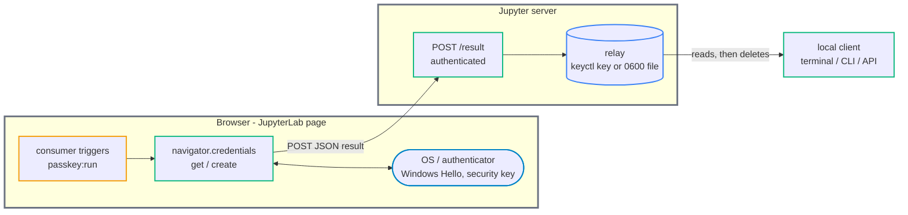
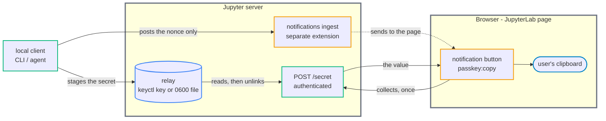

# jupyterlab_passkey_extension

[](https://github.com/stellarshenson/jupyterlab_passkey_extension/actions/workflows/build.yml)
[](https://www.npmjs.com/package/jupyterlab_passkey_extension)
[](https://pypi.org/project/jupyterlab-passkey-extension/)
[](https://pepy.tech/project/jupyterlab-passkey-extension)
[](https://jupyterlab.readthedocs.io/en/stable/)
[](https://kolomolo.com)
[](https://www.paypal.com/donate/?hosted_button_id=B4KPBJDLLXTSA)

A passkey bridge for JupyterLab that exposes the passkey (WebAuthn) capability of the user's browser or operating system to local clients with no browser of their own and returns the browser-side ceremony result to the requesting local process.

- **Purpose** - the bridge commands perform no cryptography, each caller supplies its parameters, and a tool that needs a WebAuthn PRF value keeps all key handling to itself
- **Scope** - the CLI (`jupyterlab-passkey`, installed with the package) sends every request over an authenticated HTTP API, and the [password vault](docs/usage.md#vault) is the one part that encrypts and stores secrets

## Standards

| Standard                            | Status | What the vault does                                                     |
| ----------------------------------- | ------ | ----------------------------------------------------------------------- |
| NIST SP 800-38D, RFC 5116           | ✅ Met | AES-256-GCM for all entries under one random 32-byte data key           |
| RFC 9106 Argon2id                   | ✅ Met | the recovery and unlock-password slots; a slot upgrades on its next use |
| RFC 7914 scrypt                     | ✅ Met | older recovery and unlock-password slots still open, N=2^17, r=8, p=1   |
| RFC 5869 HKDF-SHA256                | ✅ Met | the passkey slots, keyed from the WebAuthn PRF                          |
| RFC 6238 TOTP                       | ✅ Met | 6-digit codes of the authenticator app, a used code refused             |
| W3C WebAuthn Level 3, PRF extension | ✅ Met | each passkey slot is bound to one hostname                              |
| NIST SP 800-63B, AAL2 idle limit    | ✅ Met | 30-minute default unlock duration                                       |
| NIST SP 800-57 key management       | ✅ Met | the data key rotates, with a one-year default cryptoperiod              |

## Features

- **Passkeys** - `create` registers and `get` asserts Windows Hello, Touch ID or a security key from a process with no browser
- **Approval** - the user approves the ceremony in the open tab, and the call blocks until the result returns
- **PRF** - `get --prf-salt` returns the same 32 bytes for the same credential and salt, so a vault can derive its key and store none
- **`passphrase`** - prompts in the browser and prints only a reference to the staged value (`keyctl:...` or `file:...`)
- **No terminal copy** - the value never appears in the terminal, the shell history, a process argument or the CLI
- **`copy`** - places a value on the clipboard through a one-shot relay
- **`show`** - renders a code as a distorted image absent from the DOM text and the accessibility tree

### Working with an AI agent

`passphrase` and `copy` let an AI agent handle a secret without printing it.

- **Secret entry** - `passphrase --once --prompt "..."` gives an agent a reference, never a secret
- **Pipe** - `pass-cli` can send bytes into `copy` without printing them
- **Help and skill** - `--help` says what each subcommand prints and whether it waits, and [`SKILL.md`](.agents/skills/jupyterlab-passkey-extension/SKILL.md) adds the rules it cannot state
- **Why link** - the wheel installs the skill at `<sys.prefix>/share/jupyter/agents/skills/jupyterlab-passkey-extension/SKILL.md`, and no agent reads that directory, so one of the two links below makes it readable

```bash
mkdir -p ~/.agents/skills && ln -sfn "$(python -c 'import sys; print(sys.prefix)')/share/jupyter/agents/skills/jupyterlab-passkey-extension" ~/.agents/skills/jupyterlab-passkey-extension
ln -sfn "$PWD/.agents/skills/jupyterlab-passkey-extension" ~/.claude/skills/jupyterlab-passkey-extension
```

> [!IMPORTANT]
> This is not a sandbox and not a defence against a hostile caller: any process running as your uid can also read the relay named in the reference, a kernel key or a `0600` file. It prevents a secret from being captured incidentally - not echoed to a terminal, printed into a transcript, left in `~/.bash_history` or a process argument, or broadcast in a notification payload.

## How it works

A browser page can send data only over HTTP, so the ceremony result returns through an authenticated endpoint that writes a relay - a `keyctl` key or an atomic `0600` file - the local client reads.

- **Ceremony** - the browser sends the ceremony result to the local client
- **`copy`** - the local client sends a secret to the browser, and the notification contains only a nonce (see [Security](docs/usage.md#security))





## Install

```bash
pip install jupyterlab_passkey_extension
```

## Command line

`jupyterlab-passkey` is installed with the package and posts the notification with the request, waits for your click, and prints the result.

- **Caller** - every notification starts with `Asked by <name>:`, set with `--caller NAME` on any subcommand or `JLAB_PASSKEY_CALLER` from Python
- **Caller default** - without a name the caller is the project directory, which tells the person who clicks which project asks and proves nothing
- **Server** - the CLI posts only to the Jupyter server its environment names, and stops when it cannot identify which running server is the lab (flags: [cli-reference.md](docs/cli-reference.md))
- **Exit status** - `0` succeeded, `1` refused, timed out or could not reach the server, `2` an argument the parser rejects
- **Stdout** - only the result goes to stdout, so `$(...)` captures only the result
- **`copy`** - returns once posted, `--block` waits for collection only, and a terminal stdin is refused
- **`show`** - reports nothing back

| Command      | Does                                      | Prints                                                        |
| ------------ | ----------------------------------------- | ------------------------------------------------------------- |
| `create`     | registers a new passkey                   | its `cred_id`                                                 |
| `get`        | asserts a passkey                         | the PRF (with `--prf-salt`) or the `cred_id`                  |
| `passphrase` | prompts you for a secret in the browser   | a **reference** (`keyctl:...` or `file:...`), never the value |
| `copy`       | puts a secret on your clipboard           | nothing - it posts a button and returns                       |
| `show`       | shows a code as a scraper-resistant image | nothing - it posts a button and returns                       |

```bash
cred_id=$(jupyterlab-passkey create --rp-id lab.example.com)
salt=$(head -c32 /dev/urandom | base64 | tr '+/' '-_' | tr -d '=')
prf=$(jupyterlab-passkey get --rp-id lab.example.com --cred-id "$cred_id" --prf-salt "$salt")

pass-cli get github/api --field password --quiet --no-clipboard \
  | jupyterlab-passkey copy --label "GitHub token"
```

## Documentation

The vault, its panel and configuration, the server API, the frontend commands and the security notes are in [docs/usage.md](docs/usage.md).

## Requirements

- **Server and gesture** - JupyterLab >= 4.0.0 over HTTPS or localhost (a secure context), and an open tab supplies the gesture
- **Hostname** - a passkey belongs to a hostname, never an IP
- **Dependencies** - the [notifications extension](https://github.com/stellarshenson/jupyterlab_notifications_extension) is installed with the package
- **Passkeys** - `create` and `get` need a passkey, while `passphrase`, `copy` and `show` need none
- **GnuPG** - the vault needs it (`apt install gnupg`) so gpg-agent can hold the unlocked key where the kernel keyring is not allowed
- **Without GnuPG** - the vault still works with the key in server memory and reports this

## Uninstall

```bash
pip uninstall jupyterlab_passkey_extension
```

## License

BSD-3-Clause; see [LICENSE](LICENSE).
