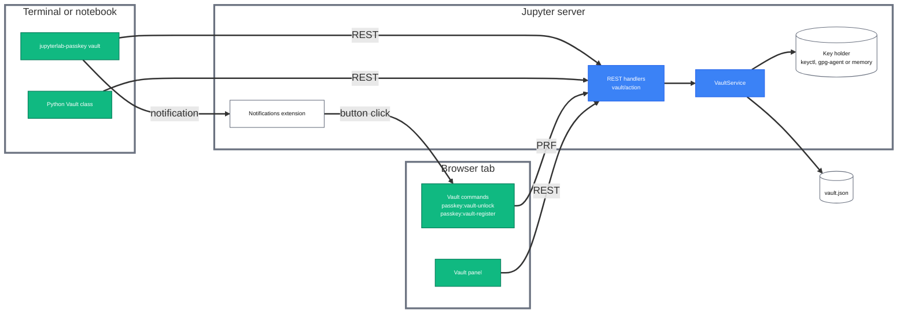
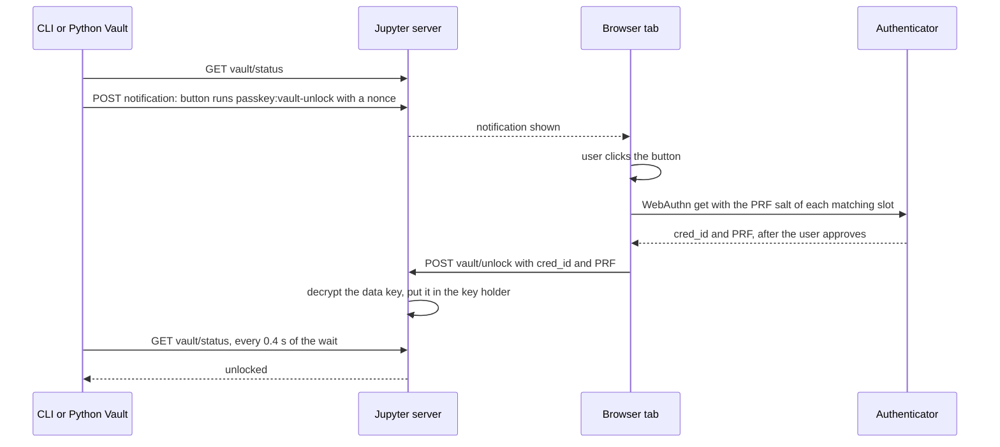

# jupyterlab_passkey_extension - Password vault design v1

Status: current for release 1.1.2, 2026-09-29.

## Contents

- [1. Overview](#1.-Overview)
- [2. Components](#2.-Components)
- [3. Vault file](#3.-Vault-file)
  - [3.1 File format](#3.1-File-format)
  - [3.2 Encryption and slots](#3.2-Encryption-and-slots)
  - [3.3 Key hierarchy and rotation](#3.3-Key-hierarchy-and-rotation)
  - [3.4 Writes](#3.4-Writes)
- [4. Unlock and lock](#4.-Unlock-and-lock)
  - [4.1 Unlock paths](#4.1-Unlock-paths)
  - [4.2 Key holders](#4.2-Key-holders)
  - [4.3 Unlock duration and lock](#4.3-Unlock-duration-and-lock)
- [5. Passkeys and hostnames](#5.-Passkeys-and-hostnames)
- [6. Proof requirements](#6.-Proof-requirements)
- [7. Reading values](#7.-Reading-values)
- [8. REST API](#8.-REST-API)
- [9. Clients](#9.-Clients)
  - [9.1 CLI](#9.1-CLI)
  - [9.2 Python API](#9.2-Python-API)
  - [9.3 Panel](#9.3-Panel)
- [10. Security limits](#10.-Security-limits)
- [11. Configuration](#11.-Configuration)

## 1. Overview

This section states what the vault is and which parts take part in it. The vault is one encrypted file of passwords per user. The Jupyter server keeps it, and a passkey, the unlock password with a code of the authenticator app, an unlock password with a passkey that has no PRF, or the recovery passphrase opens it.

- **One owner of the file** - only the Jupyter server process reads and writes the vault file; every client calls its REST API
- **Three clients** - the `jupyterlab-passkey vault` CLI, the Python `Vault` class and the sidebar panel
- **Four ways in** - a passkey added for the hostname of the browser tab, the unlock password together with a code of the authenticator app, an unlock password together with a passkey that has no PRF, or the recovery passphrase
- **One unlock for all clients** - an unlock keeps the data key for the unlock duration (default 1 minute), and the CLI, the Python class and the panel all use that one unlock
- **Passkey steps run in the tab** - WebAuthn runs only in a browser tab after a click, so the CLI and the Python class raise a notification, and its button starts the passkey step in the tab. The notification starts with the asking project, `**<caller>**:`, entry name bold (see the [CLI reference](cli-reference.md)); the name is the caller's statement, not a proof



_Fig 1 - Vault components and the calls between them_

## 2. Components

This section lists the modules of the vault and the job of each. Paths are relative to the repository root.

| Component                  | Location                                         | Description                                                                                       |
| -------------------------- | ------------------------------------------------ | ------------------------------------------------------------------------------------------------- |
| File format and encryption | `jupyterlab_passkey_extension/vault/store.py`    | reads, encrypts and writes `vault.json`                                                           |
| Authenticator codes        | `jupyterlab_passkey_extension/vault/totp.py`     | computes and checks the codes of the authenticator app                                            |
| Passkey check              | `jupyterlab_passkey_extension/vault/webauthn.py` | checks the registration and the signature of a passkey with no PRF, with Yubico's `fido2` library |
| Key holders                | `jupyterlab_passkey_extension/vault/holders.py`  | keep the data key while the vault is unlocked                                                     |
| Vault service              | `jupyterlab_passkey_extension/vault/service.py`  | unlock, lock, entries, slots and proofs; the only code that opens the file                        |
| REST handlers              | `jupyterlab_passkey_extension/vault/handlers.py` | map each `vault/<action>` request to the service                                                  |
| Client                     | `jupyterlab_passkey_extension/vault/client.py`   | REST calls and the notification step, shared by the CLI and the Python class                      |
| CLI                        | `jupyterlab_passkey_extension/vault/cli.py`      | the `jupyterlab-passkey vault` subcommands                                                        |
| Panel                      | `src/vault/panel.ts`, `src/vault/dialogs.ts`     | entry list, entry forms, and the settings and security view (the cog)                             |
| Passkey steps              | `src/vault/webauthn.ts`                          | new passkey, unlock and proof requests to the authenticator                                       |
| Authenticator setup        | `src/vault/totp.ts`                              | the setup key of a new authenticator app and its QR code                                          |
| Commands                   | `src/vault/plugin.ts`                            | `passkey:vault-unlock` and `passkey:vault-register`, run by a notification button                 |

## 3. Vault file

This section describes the file on disk, how its contents are encrypted, and how a change is written. The file is `$XDG_DATA_HOME/jupyterlab-passkey/vault.json` (`~/.local/share/jupyterlab-passkey/vault.json` by default), or the path in `JUPYTERLAB_PASSKEY_VAULT`.

### 3.1 File format

The file is one JSON document with format version 2.

```json
{
  "format": "jupyterlab-passkey-vault",
  "version": 2,
  "id": "<16 hex characters>",
  "slots": [
    {
      "type": "recovery",
      "kdf": "argon2id",
      "m": 65536,
      "t": 3,
      "p": 1,
      "salt": "<base64>",
      "wrapped": "<base64>"
    },
    {
      "type": "passkey",
      "cred_id": "<base64url>",
      "rp_id": "<hostname>",
      "prf_salt": "<base64url>",
      "hkdf_salt": "<base64>",
      "created": "<ISO 8601 UTC>",
      "wrapped": "<base64>",
      "label": "<text>"
    },
    {
      "type": "password",
      "kdf": "argon2id",
      "m": 65536,
      "t": 3,
      "p": 1,
      "salt": "<base64>",
      "created": "<ISO 8601 UTC>",
      "wrapped": "<base64>"
    },
    {
      "type": "password-passkey",
      "kdf": "argon2id",
      "m": 65536,
      "t": 3,
      "p": 1,
      "salt": "<base64>",
      "cred_id": "<base64url>",
      "rp_id": "<hostname>",
      "origin": "<https://host[:port]>",
      "created": "<ISO 8601 UTC>",
      "cose_key": "<base64: 12-byte nonce + AES-256-GCM(data key, COSE key)>",
      "wrapped": "<base64>",
      "label": "<text>",
      "sign_count": 7
    }
  ],
  "entries": "<base64: 12-byte nonce + AES-256-GCM ciphertext>",
  "data_key": {
    "created": "<ISO 8601 UTC>",
    "sealed": "<base64: 12-byte nonce + AES-256-GCM ciphertext>"
  },
  "authenticator": {
    "created": "<ISO 8601 UTC>",
    "secret": "<base64: 12-byte nonce + AES-256-GCM ciphertext>"
  }
}
```

- **`id`** - random per vault; it names the data key in the key holder, so two vaults of one user never read each other's key
- **`slots`** - one recovery slot, zero or more passkey slots, at most one unlock password slot, which is added and removed together with `authenticator`, and at most one `password-passkey` slot, which has its own password
- **`entries`** - all entries, names included, encrypted as one JSON list
- **`data_key`** - the data key sealed under the root key; its `created` date is where the rotation period counts from
- **`authenticator`** - present only while the vault has an authenticator app; its secret is encrypted, so a locked vault tells that an app exists and since when, nothing more
- **Entry fields** - `name`, `username`, `password`, `url`, `category`, `notes`, `created`, `updated`
- **Limits** - a name is at most 200 printable characters; a field is at most 65,536 characters

### 3.2 Encryption and slots

The root key is 32 random bytes, and each slot holds one copy of it, encrypted under a key derived from one secret. The data key is 32 random bytes that encrypt the entries; the root key seals it. [3.3](#3.3-Key-hierarchy-and-rotation) has the two-key hierarchy and the rotation.

| Item                      | Encrypted under               | Algorithm                                                                                                    |
| ------------------------- | ----------------------------- | ------------------------------------------------------------------------------------------------------------ |
| Entries                   | the data key                  | AES-256-GCM, 12-byte nonce                                                                                   |
| Data key                  | the root key                  | AES-256-GCM, 12-byte nonce, with associated data of its own                                                  |
| Recovery slot             | the recovery passphrase       | Argon2id with m = 65,536 KiB, t = 3, p = 1 and a 16-byte salt (64 MiB of memory per guess), then AES-256-GCM |
| Passkey slot              | the PRF output of the passkey | HKDF-SHA256 with a 16-byte salt, then AES-256-GCM                                                            |
| Password slot             | the unlock password           | Argon2id with the same parameters as the recovery slot, then AES-256-GCM                                     |
| App secret                | the data key                  | AES-256-GCM, 12-byte nonce, with associated data of its own                                                  |
| Password and passkey slot | its own unlock password       | Argon2id with the same parameters as the recovery slot, then AES-256-GCM                                     |
| Public key of that slot   | the data key                  | AES-256-GCM, 12-byte nonce, bound to the slot's fields                                                       |

- **PRF** - the WebAuthn PRF extension: the authenticator returns 32 bytes computed from the passkey and the slot's `prf_salt`; the same passkey and salt always return the same bytes
- **Any slot unwraps the root key** - every slot holds the same one, and the root key opens the data key
- **The authenticator app is no slot** - its secret is data inside the vault, not a key to it. A code takes no part in the encryption: the password slot unwraps the root key, and the server keeps the data key only for a right code
- **A passkey with no PRF is no slot key** - it gives no repeatable secret, so it cannot wrap the root key. The `password-passkey` slot is unwrapped by its password alone, and the server keeps the key only for a verified signature of the passkey. The passkey takes no part in the encryption
- **Slot changes leave the entries as they are** - adding or removing a slot never re-encrypts the entries
- **Slot fields are authenticated** - every slot field except `wrapped`, `label`, `cose_key` and `sign_count` is bound to the encryption as associated data, so a changed salt, cost, credential id, hostname or origin fails to open. `cose_key` is sealed with those same fields
- **Older slots** - a recovery or password slot written by an earlier build keeps its scrypt parameters and still opens; the slot used at an unlock is rewritten under Argon2id on that unlock, so no re-entry is needed
- **No downgrade after an Argon2id write** - any recovery or password slot this build writes, at init, at a recovery change or at an unlock upgrade, is Argon2id and an older build cannot open it, while passkey slots remain readable
- **Cost per slot** - each recovery and password slot stores its own KDF parameters (Argon2id today, scrypt in older slots), so a higher cost for new slots leaves existing slots readable

### 3.3 Key hierarchy and rotation

This subsection describes the two keys, the migration from version 1, and the rotation of the data key.

- **Root key** - 32 random bytes, wrapped by every slot under that slot's key-encryption key; any one slot unwraps it, so adding or removing a slot never re-encrypts an entry
- **Data key** - 32 random bytes, sealed under the root key; it encrypts the entries, names included, the secret of the authenticator app, and the public key of a Password and passkey slot, each as one AES-256-GCM ciphertext
- **Rotation** - re-seals the entries, the authenticator secret and the public key of a Password and passkey slot under a new random data key and discards the previous data key, so a copy of the old key stops reading the vault and no slot's wrapped key changes
- **Proof** - a rotation needs an unlocked vault and a proof: the current recovery passphrase or a passkey with PRF. A code of the authenticator app and a passkey with no PRF hold no key and are refused
- **Cryptoperiod** - `rotate_days` in the server configuration file, default 365 days (one year), range 0 to 3,650; 0 turns automatic rotation off
- **Automatic rotation** - an unlock rotates a data key at or past its cryptoperiod. This is best effort: a rotation that cannot be written is logged, and the unlock stands with the key it opened
- **Manual rotation** - `jupyterlab-passkey vault rotate`, `Vault.rotate()` or the panel's Rotate data key button, each with a proof
- **Version 2** - version 1 had one key for both jobs. At its next unlock such a file gains a data key, and no slot is rewrapped: the slots already wrap what is now the root key. The file is then version 2, which an older build refuses
- **Policy** - the rotation period and the other vault settings are organisation-controlled in the server's configuration file, `$XDG_STATE_HOME/jupyterlab-passkey/vault-config.json` (`~/.local/state` by default); an absent or invalid key uses its default (section 11)

### 3.4 Writes

Every change is a read, a change and a write under one exclusive lock.

- **Lock** - `flock` on `<vault>.lock` beside the file
- **Write** - a temporary file in the same directory, `fsync`, mode `0600`, rename over the vault, `fsync` of the directory
- **Wrong key** - a write first decrypts the current entries with the data key it holds, so a wrong key never overwrites the file
- **Directory** - created with mode `0700` when it does not exist

## 4. Unlock and lock

This section describes how the server takes the root key out of a slot, opens the data key with it, where it keeps the data key, and how it is removed.

### 4.1 Unlock paths

The server unwraps the root key from one slot, opens the data key with it, and puts the data key in the key holder for the unlock duration. Five requests do this.

- **Passkey** - the tab sends one WebAuthn request that offers the passkeys added for its hostname (section 5), each with its own `prf_salt`; it then sends the `cred_id` and the PRF to `POST vault/unlock`. The passkey slot stays HKDF over the PRF and is not rewritten
- **Recovery passphrase** - `POST vault/unlock` with the passphrase; the CLI reads it from a hidden prompt, from stdin, or from a browser dialog with `--in-browser`. After the unlock, the recovery slot is rewritten under Argon2id if it was scrypt; a failed rewrite is logged and the unlock stands
- **Unlock password and code** - `POST vault/unlock` with the password and a code of the authenticator app. The server unwraps the root key with the password, opens the data key with the root key, reads the app's secret with the data key, and puts the data key in the holder only for a right code that was not used before; the password slot is then rewritten under Argon2id if it was scrypt, and a failed rewrite is logged and the unlock stands. The CLI asks both with `vault unlock --password`, at a terminal or with `--in-browser`
- **Unlock password and passkey** - the page gets a one-use challenge from `POST vault/challenge`, runs a WebAuthn request, and sends the password and the assertion to `POST vault/unlock`. The server unwraps the root key with the password, opens the data key with it, opens the slot's public key with the data key, verifies the assertion, and puts the keys in the holder only after that. The password is typed in the tab; `vault unlock --password` hands over to the tab. One unlock makes one passkey request, and the page asks no PRF
- **Create** - `POST vault/init` creates the vault with an Argon2id recovery slot and leaves it unlocked

When the CLI or the Python class starts a passkey unlock, the PRF goes from the tab to the vault endpoint. The result relay (a kernel key, or a `0600` file in `/dev/shm`) carries only the error line of a failed unlock or set-up back to the CLI; the CLI reads a success in vault status.



_Fig 2 - A passkey unlock started from the CLI_

### 4.2 Key holders

The server keeps the data key in the first key holder that works on the host, tried in the order keyctl, gpg-agent, memory. Hosts differ: a seccomp profile can forbid the kernel keyring, and GnuPG can be missing.

| Capability               | keyctl              | gpg-agent                                                                 | memory                                     |
| ------------------------ | ------------------- | ------------------------------------------------------------------------- | ------------------------------------------ |
| Where the key is         | kernel keyring `@u` | a gpg-agent with its own GnuPG home                                       | Jupyter server process memory              |
| Never in swap            | yes                 | measured on the agent process                                             | yes with `memfd_secret` or `mlock`         |
| Never in crash dumps     | yes                 | measured on the agent process                                             | yes with `memfd_secret` or `MADV_DONTDUMP` |
| Expires on its own       | yes, kernel timeout | yes, agent `max-cache-ttl`                                                | no, a timer in the server removes it       |
| Locks on server restart  | no                  | no                                                                        | yes                                        |
| Isolated from containers | no                  | yes when the agent socket is outside `$XDG_STATE_HOME/jupyterlab-passkey` | yes                                        |

- **Choice** - `JUPYTERLAB_PASSKEY_VAULT_HOLDER` pins `keyctl`, `gpg-agent` or `memory`; a pinned holder that does not work is an error
- **keyctl test** - keyctl is chosen only after a real add, search and read of a test key succeeds
- **keyctl possession** - `timeout` and `pipe` name a key by number, and the kernel allows that only to a process whose session keyring leads to the key. The path is a keyring named `jlab-passkey:possess.<id of @u>` inside the session keyring, with `@u` linked into it. A direct link of `@u` in the session keyring is not used: a sandboxed process that shares the session keyring has its own `@u` of the same name, a keyring holds one key per name, so its link would replace the server's and refuse every later unlock
- **Refused call** - a `timeout` or `pipe` refused with `Permission denied` restores the path once and runs again, so a missing path needs no restart. A second refusal fails the call
- **Keyring lifetime** - each `jlab-passkey:possess` keyring expires a day after the last test or refused call that reached it, because a user namespace that ended leaves its keyring behind and each one counts towards the key quota of the user id. A process that still runs makes its keyring again at its next refused call
- **Failed hold** - a read of the held key runs before a new key replaces it, and a read refused with `Permission denied` stops the replacement, so an unlock that cannot hold its key leaves a held key in place. The read adds no key, so a full key quota refuses no unlock of an open vault: the replacement frees the two keys it adds. `vault status` reads the vault as locked when the key cannot be read, so it agrees with the entries
- **New data key** - a rotation or a version-1 file gaining a data key clears the held key as soon as the file is written, in every holder, because that key no longer reads the entries. A hold that fails after that leaves a locked vault, and the next unlock opens it
- **gpg-agent** - a separate agent under `$XDG_STATE_HOME/jupyterlab-passkey/gnupg`, never the user's `~/.gnupg` one, because its `max-cache-ttl` would change the user's own gpg and ssh caching
- **Protection level** - `strong` when the key is kept out of swap and out of crash dumps, `reduced` with one of the two, `basic` with neither
- **Shown to the user** - `vault status` and the cog view show the chosen holder and each capability; when the memory holder is chosen, the server logs why gpg-agent was skipped and the panel shows the same line

### 4.3 Unlock duration and lock

This subsection covers how long a key stays and what removes it earlier.

- **Duration** - the `unlock_minutes` key, 1 to 1,440 minutes, default 1
- **Storage** - the server reads `unlock_minutes`, `password_min_length`, `reveal_seconds` and `rotate_days` from `$XDG_STATE_HOME/jupyterlab-passkey/vault-config.json` on each read; an absent or invalid key uses its default (section 11)
- **When it applies** - at the next unlock from any client; a key already held keeps its expiry
- **Lock** - `vault lock`, `Vault.lock()` or the panel's Lock button removes the key from the holder
- **Server restart** - with keyctl or gpg-agent the key can stay held after a restart until the duration ends; with the memory holder a restart locks the vault

## 5. Passkeys and hostnames

This section describes which hostname a passkey belongs to. WebAuthn binds each passkey to one relying-party id (RP ID), and the vault uses the hostname of the browser tab as that id.

- **Source of the hostname** - the tab reads `location.hostname` for a new passkey, unlock, reveal and proof; the server stores the `rp_id` the tab sends
- **Proxies** - the server reads no `Host` or `X-Forwarded-Host` header, so a server on localhost behind a chain of proxies records the hostname in the user's address bar
- **Scope** - a passkey opens the vault from its hostname or from a subdomain of it
- **Most specific hostname** - WebAuthn takes one RP ID per request, so the tab offers the passkeys of the longest hostname that has a passkey and matches
- **One passkey per hostname** - JupyterLab opened at two hostnames needs a passkey added at each
- **IP address** - a tab at an IP address such as `127.0.0.1` cannot use a passkey; the tab refuses and names the hostnames that have passkeys
- **Two requests to add a passkey** - a WebAuthn `create` makes the passkey, then a `get` with a new random `prf_salt` returns the PRF, because some authenticators, Windows Hello among them, return a PRF only at `get`. The `create` and the `get` sign one server challenge, because for a passkey with no PRF the `create` is the registration the server checks and the same `get` is the signature
- **Two dialogs to add a passkey** - the user names the passkey in a dialog before the `create`, and confirms it in a second dialog before the `get`; each button is the click the browser needs for its request. A passkey with no PRF adds no passkey prompt: it goes on to the offer and the new password
- **Name in the passkey manager** - `JupyterLab vault - <UTC time> - <hostname>`, so two passkeys of one vault can be told apart
- **No PRF** - an authenticator that returns no PRF cannot hold a vault key. The panel offers Password and passkey in the same flow: a new unlock password decrypts, and the passkey is a check the server makes. Declined, or cancelled at a later step, the failure says what happened, then the ways in: `passkey not added, no PRF - use another passkey or Password and authenticator app`. It gives no advice to try again, because the same authenticator fails again. The passkey the browser created is then an unused passkey (section 9)

## 6. Proof requirements

This section lists which requests need a proof. A proof is sent with the request and is one of four: a passkey answer (`cred_id` and PRF), the current recovery passphrase, a code of the authenticator app, or a passkey with no PRF, verified against the public key the vault holds. From the first two the server unwraps the root key and opens the data key itself instead of taking it from the holder. A code and a passkey with no PRF hold no key, so each is a proof only while the vault is unlocked: the server checks a code against the app's secret and a signature against the passkey's public key, and takes the data key from the holder. The unlock password alone is a fifth proof for one request only, showing a password in the panel. After an unlock in a browser tab, or a proof accepted there, that tab's panel shows a password with no proof for the `reveal_seconds` setting (default 60 seconds, range 0 to 3,600); an unlock from a terminal starts no window in any tab, and 0 asks for a proof at every reveal. A locked vault shows no password, whatever the proof. Every request also needs the Jupyter server token.

| Request                                   | Needs                                                                                                                                   |
| ----------------------------------------- | --------------------------------------------------------------------------------------------------------------------------------------- |
| Add a passkey                             | a proof                                                                                                                                 |
| Replace the recovery passphrase           | a proof                                                                                                                                 |
| Show a password in the panel              | an unlocked vault, and a proof or the unlock password; neither in the tab's `reveal_seconds` window                                     |
| Add the password and authenticator app    | a proof, the new password, and the code the app shows for its secret                                                                    |
| Add the password and passkey              | a proof, the new password, and the registration and a signature of the new passkey, both over one server challenge                      |
| Rotate the data key                       | an unlocked vault, and a proof: a passkey with PRF or the recovery passphrase; a code alone and a passkey with no PRF alone are refused |
| Remove a passkey                          | an unlocked vault                                                                                                                       |
| Remove the password and authenticator app | an unlocked vault                                                                                                                       |
| Remove the password and passkey           | an unlocked vault                                                                                                                       |
| Read, add, edit or delete an entry        | an unlocked vault                                                                                                                       |
| Change the unlock duration                | nothing more                                                                                                                            |

The vault's unlock methods, and what each may do:

| Unlock method                  | How many                      | Unlocks the vault                          | Shows a password in the panel, vault unlocked | Adds an unlock method, changes the recovery passphrase                |
| ------------------------------ | ----------------------------- | ------------------------------------------ | --------------------------------------------- | --------------------------------------------------------------------- |
| Recovery passphrase            | exactly one, never removed    | yes                                        | yes                                           | yes                                                                   |
| Passkey                        | any number, one hostname each | yes                                        | yes                                           | yes                                                                   |
| Password and authenticator app | at most one pair              | yes, the password and a code together      | yes, a code alone or the password alone       | a code alone, while the vault is unlocked; the password alone no      |
| Password and passkey           | at most one pair              | yes, the password and the passkey together | yes, the passkey alone; the password alone no | the passkey alone, while the vault is unlocked; the password alone no |

- **One rule on the server** - `PROOFS` in `service.py` names the kinds of proof and the one that proves a reveal only; the REST handler and the two refusals that list the proofs read it
- **Why a proof** - a new passkey and a new recovery passphrase each open the vault later, an authenticator app proves both, and an unlocked vault proves nothing about who asks now
- **Order in the tab** - a passkey added for the tab's hostname first. With none, or when the passkey request gets no answer or returns no PRF: a passkey with no PRF, when the vault has one for this address and is unlocked, with a button to use another proof; then a code when the vault has an app and is unlocked, with a button for the recovery passphrase; otherwise the recovery passphrase. A rotation offers neither the passkey with no PRF nor a code
- **Order in the entry dialog** - a passkey added for the tab's hostname first, else a passkey with no PRF when the vault has one for this address. With none, or no answer: a row under the password asks a code when the vault has an app, with a link to the unlock password, then to the recovery passphrase, and from the last of them back to the first
- **No second proof for the reveal window** - after an unlock in a tab, by any method, or a proof accepted there (a password shown, a passkey or the pair added, the recovery passphrase changed), the eye in that tab shows a password and asks nothing for the `reveal_seconds` setting: the person at the screen has just proven. The setting is stored on the server, defaults to 60 seconds and ranges 0 to 3,600; 0 asks a proof at every reveal. An unlock sent by the CLI or Python starts no window, because no tab took part in it. A new unlock method, a data key rotation and a recovery passphrase change ask their proof in that window too. The window ends when the setting's time is over, when the tab locks the vault and when the page is reloaded. A passkey unlock or a new passkey that the CLI raises is done by the tab that answers the notification, and both start the window there
- **The tab counts the window** - the eye's proof is asked by the tab, so the tab keeps the time of its last unlock or accepted proof (`VaultApi.proven`); the window's length comes from `settings.reveal_seconds` in every status the server answers. Inside the window the eye sends the plain read that `vault get` sends. The server answers that read for every request on an unlocked vault, so a count kept on the server would refuse nothing
- **The pair's flow** - the panel asks the new unlock password twice, then the proof, then shows the app's QR code and asks its code. The code is typed last, because the server checks it with the request and a code stays right for less than a minute. That same request checks the proof, after the app took the setup key: when the server refuses the request for another reason than a wrong code (a proof refused there, a pair added elsewhere meanwhile), the failure says that the entry the app added is unused, so the user can delete it. A lost answer and a 5xx answer get no such sentence, because the pair may have been added
- **The flow of Password and passkey** - it follows the failed PRF check. The page reads a server challenge before the dialog whose click the `create` follows, and the `create` and the `get` both sign it. The `create` is the registration and the `get` that tested for PRF is the signature, so the method adds no prompt. The offer, the new password and, where the proof was a code, a new code follow, and one request stores the slot. A 4xx answer reports the passkey unused. A lost answer and a 5xx answer say the method may have been added and name the cog, because the slot may have been stored. A passkey with PRF takes the same two prompts and the same challenge, and stores no public key. With an assertion proof, which holds the one live challenge, the page reads no challenge and the two prompts sign one the page makes: that vault has Password and passkey already, so a passkey with no PRF is refused before any request
- **A code can expire where the proof comes first** - a new passkey and a recovery passphrase change ask the proof before their other steps (a name and two passkey prompts; the new passphrase typed twice). A code typed there is refused as `wrong code` when those steps take longer than the code stays right, and that refusal counts as a wrong code. The code dialog's Use recovery passphrase button gives the proof that does not expire; after a refused new passkey the panel names the passkey the browser created, so the user can delete it
- **A recovery passphrase is checked when typed** - the tab sends it to `proof-check` before the next step, in every flow that asks the proof: a new passkey, the pair, a recovery passphrase change, a rotation and `passkey:vault-register`. A wrong one reaches no browser prompt and no authenticator app, so it leaves no unused passkey, and an authenticator with no PRF gets the same answer. A refusal opens the same dialog again with the line `Wrong recovery passphrase`; Cancel ends the flow, and any other failure ends it with that failure
- **The check changes nothing** - `proof-check` reads the file and runs `_proven_root`. It writes nothing, upgrades no slot, puts no key in the holder and starts no reveal window. The request that acts carries the proof again and checks it, so a passphrase changed in between is still refused there. The action has no attempt limit, because `POST unlock` answers the same question to the same signed-in user with none
- **A code is checked only by the request that acts** - `_check_code` uses a code up, and a code can expire during the later steps
- **No relay** - the tab asks for the proof itself, so no secret reaches the page through a relay
- **Unlock password** - it opens the vault only together with a code. Alone it shows a password on an unlocked vault, and it is refused as a proof for a new passkey, a new pair and a recovery passphrase change. The password of Password and passkey opens the vault only with that passkey and proves nothing alone
- **A code is a check, not encryption** - a code has six digits and changes every 30 s, so it cannot be key material. The password slot alone decrypts the data key; the server refuses to keep that key without a right code. What that leaves open is in [10. Security limits](#10.-Security-limits)
- **A passkey with no PRF is a check, not encryption** - it signs a server challenge, and the signature changes with every challenge, so it cannot be key material. The password slot of this method alone decrypts. The server checks the assertion with Yubico's `fido2` library, which runs the WebAuthn verification steps: type, challenge, origin, relying party hash, user presence, user verification, credential and signature. It refuses a cross-origin request and a sign count that did not rise itself, because the library leaves both to the caller. At registration the server runs the WebAuthn registration steps on the `create` with the library's `register_complete`: type, the same challenge, the exact origin, relying party hash, user presence and user verification. The public key it keeps is the COSE key of that result's attested credential data, as CBOR bytes, the form the library takes back to check each signature, and the `get` that follows proves the page holds that key. A slot that holds a key in any other form, such as SPKI DER, verifies nothing. The server refuses a cross-origin `create`, a credential id other than the one sent, and a key other than ES256 on P-256 or RS256 of 2048 bits or more. The attestation statement is not verified (attestation `none`). Every refused check answers 403 `the passkey check failed or expired - try again`. What that leaves open is in [10. Security limits](#10.-Security-limits)
- **One challenge** - `POST vault/challenge` answers 32 random bytes as 43 base64url characters, kept in the server's memory for 600 s and never in the file. A new challenge replaces the last, and the request that names one uses it up before any password is derived, whether or not it succeeds. The challenge names no action and no tab
- **One pair** - the vault holds at most one unlock password and one authenticator app, added in one request and removed in one. The tab creates the app's secret (160 bits), shows it as a QR code and as a setup key, and the server stores the two only for a right code and a proof. A new password or a new phone means Remove, then add again
- **Own password** - Password and passkey has its own slot and its own password, and a vault holds at most one. Adding or removing it leaves the password and authenticator app as they are
- **Exact address** - the server stores the origin of the check and compares it exactly: scheme, hostname and port. The server reads no proxy header
- **Vaults of 1.1.28 to 1.1.31** - those builds added the password and the app apart from each other. A password with no app still unlocks alone; the panel's row and `vault status` say which half is there, and Remove removes it
- **Codes** - RFC 6238 with HMAC-SHA-1, 6 digits and a 30 s time step, the parameters every authenticator app supports. The step before and the step after the current one are accepted
- **A code is accepted once** - the server refuses a code of a time step at or before the last one it accepted, so the code that unlocked the vault or added the pair is refused as a proof until the app shows its next code. The reveal window keeps the eye clear of this in the tab that unlocked or proved: when that tab asks a proof again, the app shows a later code. With `reveal_seconds` at 0, or in another tab, the eye can get this refusal at once; its line says to wait for the next code, and the unlock password shows the password without a wait
- **Five wrong codes** - after five wrong codes in a row the server refuses every code, at unlock too, until the vault is unlocked with a passkey or the recovery passphrase; a passkey and the recovery passphrase still prove, and the unlock password alone still shows a password. Both counts are in the server's memory and start again when the server does
- **A passkey check is not counted** - a signature cannot be guessed and a challenge is used once, so a failed check counts nothing, and the count of wrong codes stops no passkey check

## 7. Reading values

This section describes the path each value takes out of the vault. A listing never carries passwords.

| Request                     | Path of the value                                                                                         | Where it ends                                                       |
| --------------------------- | --------------------------------------------------------------------------------------------------------- | ------------------------------------------------------------------- |
| `vault get`, `Vault.get()`  | REST answer to the client process                                                                         | stdout of the CLI, or a Python string                               |
| `vault exec --env VAR=NAME` | REST answer to the CLI process                                                                            | the environment of the command; the CLI process becomes the command |
| `vault copy`                | server stages it in the relay; the tab collects it on the click                                           | the browser clipboard                                               |
| `vault show`                | server stages it in the relay; the tab collects it on the click                                           | a distorted image in the tab                                        |
| Panel eye button            | a proof asked in the entry dialog, or none in the tab's `reveal_seconds` window; then `POST vault/reveal` | the entry dialog                                                    |
| `vault list`, panel list    | REST answer                                                                                               | names and fields without passwords                                  |

- **copy and show** - the value never enters the CLI process
- **Staged value lifetime** - 900 s as a kernel key, or until the next reboot as a file in `/dev/shm` when keyctl does not work; `vault lock` does not remove a staged value
- **Relay** - the same one-shot relay as the bridge commands `copy`, `show` and `passphrase` (`jupyterlab_passkey_extension/relay.py`)

## 8. REST API

This section lists the endpoints. Each is `<base_url>/jupyterlab-passkey-extension/vault/<action>`, requires the Jupyter server token, and never logs a body, a value or a result.

| Method | Action             | Body or query                                                                               | Answer                    |
| ------ | ------------------ | ------------------------------------------------------------------------------------------- | ------------------------- |
| GET    | `status`           | -                                                                                           | state, see below          |
| GET    | `entries`          | -                                                                                           | entries without passwords |
| GET    | `generate`         | `length` (8 to 256, default 24), `symbols` (`0` for none)                                   | a new password            |
| POST   | `config`           | `unlock_minutes`, `password_min_length`, `reveal_seconds`                                   | 204                       |
| POST   | `challenge`        | -                                                                                           | `challenge`               |
| POST   | `init`             | `recovery`                                                                                  | 204                       |
| POST   | `unlock`           | `recovery`, or `password` and `code`, or `password` and `assertion`, or `cred_id` and `prf` | state                     |
| POST   | `lock`             | -                                                                                           | 204                       |
| POST   | `entries`          | `name`, `fields`                                                                            | 204                       |
| PATCH  | `entries`          | `name`, `fields`; only the fields given change                                              | 204                       |
| POST   | `delete`           | `name`                                                                                      | 204                       |
| POST   | `reveal`           | `name` and `field`, or `name` and a proof's keys                                            | `value`                   |
| POST   | `proof-check`      | `current` (the recovery passphrase)                                                         | 204                       |
| POST   | `stage`            | `name`, `field`, `kind` (`secret` or `code`)                                                | `nonce`                   |
| POST   | `import`           | `entries`, a list of entry objects                                                          | `added`, `skipped`        |
| POST   | `passkeys`         | `cred_id`, `rp_id`, `prf_salt`, `prf`, `label`, `proof`                                     | 204                       |
| POST   | `password-passkey` | `password`, `cred_id`, `rp_id`, `registration`, `label`, `assertion`, `proof`               | 204                       |
| POST   | `passkeys-remove`  | `cred_id`                                                                                   | 204                       |
| POST   | `recovery`         | `recovery`, `proof`                                                                         | 204                       |
| POST   | `mfa`              | `password`, `secret` (the setup key), `code`, `proof`                                       | 204                       |
| POST   | `mfa-remove`       | -                                                                                           | 204                       |

- **State** - `initialized`, `unlocked`, `remaining` seconds, `holder` with its capabilities, slot fields without the wrapped keys, salts and the sealed public key, `authenticator` with the date the app was added or null, `settings`, `path`, `revision`
- **A proof's keys** - `cred_id` and `prf`, or `current` (the recovery passphrase), or `code`, or `assertion` (a passkey with no PRF: `cred_id`, `client_data`, `authenticator_data` and `signature`, base64url), or for a `reveal` only `password` (the unlock password); `proof` is an object of the same keys. A `reveal` with none of them is the plain read: the CLI's `vault get`, and the panel's eye in the tab's `reveal_seconds` window. A `reveal` on a locked vault answers 423, whatever the proof
- **`passkeys-remove`** - it also removes Password and passkey for its `cred_id`
- **`proof-check`** - 204 for the right recovery passphrase and 403 `wrong recovery passphrase` for any other value, on a locked vault too. See [6. Proof requirements](#6.-Proof-requirements)
- **`revision`** - the first 16 hex characters of a SHA-256 of the encrypted entries; it changes with every entry change, and it tells nothing about the entries
- **Generated password** - leaves out `l I 1 | O 0`, quotes, backslash, backtick and space, because a user reads it off an image or types it on a phone
- **Errors** - the body is `{"error": "<one line>"}` with the status below

| Status | Meaning                                                                                                                                        |
| ------ | ---------------------------------------------------------------------------------------------------------------------------------------------- |
| 400    | refused: wrong passphrase, password or passkey at unlock, invalid input, no vault file                                                         |
| 403    | the proof did not open the vault, or the code is wrong, used, refused, or missing at a password unlock, or the passkey check failed or expired |
| 404    | no entry with that name, or no such action                                                                                                     |
| 409    | an entry with that name exists, or the vault already has a password and authenticator app, or a password and passkey                           |
| 423    | the vault is locked                                                                                                                            |
| 500    | a key holder or file failure; the log line names the action and the exception type only                                                        |

## 9. Clients

This section describes what each client adds to the REST API.

### 9.1 CLI

The CLI is `jupyterlab-passkey vault <command>`. Its full reference is [cli-reference.md](cli-reference.md).

- **Server** - chosen by the [CLI reference](cli-reference.md#how-the-server-is-found) selection rule, with that server's token
- **No secret on the command line** - a new secret comes from a hidden prompt typed twice, from stdin, from a browser dialog with `--in-browser`, or from `--generate`
- **Number of fields** - the vault decides by the kind of secret, in the panel and with `--in-browser`, and no control leaves it to the user: two matching fields for a recovery passphrase and a new unlock password, one for an entry value, an unlock and a proof. The calling agent decides for the `passphrase` command with `--twice`; the default is one. A blind terminal prompt asks every new secret twice
- **Locked vault** - a read raises the unlock notification, then runs once more. An unlocked vault raises none
- **One shared unlock** - processes of one user share an unlock. The first process claims it under a file lock in the relay directory, in a record that holds no secret and names that process, and raises the one notification. The others raise none and wait on vault status, so one press lets all go on. The first process watches vault status too, because the unlock can come from the panel, another tab or a terminal. A status read that fails ends no wait: only an unlock, a cancel, a failure of the unlock itself or the deadline does
- **The record** - a record that does not parse counts as no record. On the keyctl relay backend, whose relays need no directory, a relay directory that cannot be used leaves the record out: each process raises its own notification. On shm it is the one line `cannot use the relay directory`, because the relays need that directory
- **First set-up from git** - with no vault the helper raises `Set up vault`, by the record of the shared unlock: the first process raises the one notification, and the others wait on vault status until `vault/init` opens the vault. That process waits up to 180 s for vault status to show a vault, made by its page or in the panel, so the lookup runs while the tab offers the methods. A cancelled or failed recovery step ends every wait with its line. After a notification nobody answered, a later request fails at once for 10 minutes and names `jupyterlab-passkey vault init`. A vault that exists, with any methods, never raises this: it unlocks the normal way
- **The end of a shared unlock** - the server removes the record on every unlock. A cancelled or failed unlock is recorded for 5 s and ends every wait with its line; a claim that a new process writes over it keeps that line, so a wait that reads the claim ends with it. After a notification nobody answered, a later read fails at once for 10 minutes and names `jupyterlab-passkey vault unlock`; that command, and an unlock by any other way, ends the refusal. A claim whose process is gone counts as none, so the next process raises the notification at once. A claim that goes with its process ends no wait: one waiting process claims and raises the notification in its place, within the time left of its own wait, and the other waiting processes share that claim. The set-up a git request raises does the same, and its waits end once vault status shows a vault. The process that raised the notification removes its own claim when its wait ends, however it ends, Ctrl-C included, so a claim written just after an unlock does not outlive it
- **One prompt** - the page's unlock command reads the vault state first and asks nothing on an unlocked vault, and a click during a running unlock shares it, the panel's button included. That read stands between the click and the WebAuthn call, and a browser can end the click's user activation at a network read: Safari may refuse the passkey request that follows it. A refusal after the passkey answered, or an answer with no PRF, reaches the CLI as its one line and opens no chooser
- **A notification nothing waits for** - the CLI names its command and its wait in the notification's data. While an unlock or set-up notification is in a tab, that tab reads vault status every 15 s, with the panel hidden too; a hidden browser tab reads when it is shown again. The notification leaves once a read begun after it came shows the vault unlocked, or for a set-up a vault, and once the wait of the CLI that raised it has run out. A read begun before it came can predate the lock that raised it, so it removes nothing. A press reads the state before it asks anything, also before the tab's next read: on an open vault, or for a set-up on a vault that exists, it asks nothing and the notification leaves, and a read that fails asks nothing and raises a failure notification. Limit: a notification whose CLI was stopped or got a failure stays until that CLI's wait would have ended
- **Waiting** - a browser step waits 120 s for the click by default, 180 s for `vault init`, `vault passkey add` and the set-up a git request raises
- **`vault init` keeps its passkey step** - the CLI has no command that adds the pair, so a failed or cancelled passkey step exits with a line naming `vault passkey add` and Password and authenticator app under the cog
- **Agent skill** - `.agents/skills/jupyterlab-passkey-extension/SKILL.md`, also installed with the wheel, points an agent at `--help` and states which commands keep a value out of its output

### 9.2 Python API

The `Vault` class in `jupyterlab_passkey_extension.vault` uses the same REST calls as the CLI.

- **Methods** - `status()`, `list()`, `get(name, field="password")`, `unlock(recovery=None, password=None, code=None)`, `lock()`
- **Locked vault** - `get()` and `list()` raise the unlock notification, then run once more
- **Refusal** - raises `VaultClientError` with the one-line reason. `unlock(password=...)` on a vault whose only unlock password is that of Password and passkey is refused with a line that names `jupyterlab-passkey vault unlock`, because that password goes with the passkey in the tab

### 9.3 Panel

The panel sits in the right sidebar by default; the `sidebar` setting moves it to the left.

- **Refresh** - while visible, it reads the state and, when unlocked, the entry list every 15 s, and at once when it is shown again. While an unlock or set-up notification is in the tab, the state is read every 15 s with the panel hidden too
- **Changes from elsewhere** - a new `revision` or a changed slot list redraws the panel, so changes made from the CLI or another tab appear
- **Eye button** - in the `reveal_seconds` window after an unlock or a proof in the tab (default 60 seconds, 0 asks every time) the eye shows the password at once. After it a password shows only after a proof, even when the vault is unlocked. The eye asks a passkey; while that request runs it shows a spinner and the line under the field reads `Waiting for your passkey`. With no passkey for the hostname it asks the passkey of Password and passkey added at this address, with no dialog. With neither, or no answer, a row under the field asks a code of the authenticator app, the unlock password or the recovery passphrase
- **Set-up** - Create vault, and the page's `passkey:vault-setup`, ask the recovery passphrase in two fields, send `POST vault/init`, then open one dialog with Passkey, Password and authenticator app, and Later. The passphrase just chosen is the proof for either method. A step that fails or is cancelled opens the dialog again with the reason as a line in its body, the unused passkey or app entry named when there is one: a notification has `z-index` 9999 and the dialog's backdrop 10000, so a notification would stay behind it. Later, or Escape, ends the set-up with the vault created and unlocked and the recovery slot alone, with no failure line. A tab at an IP address, which cannot hold a passkey, shows the dialog with no Passkey. `passkey:vault-setup` on a vault that exists asks nothing and posts nothing
- **Failed actions** - a failed action is a JupyterLab notification with no timeout: amber for a passkey the browser created that the vault did not take and for a dismissed passkey prompt, red for any other failure. The panel draws no line for it in any view. The user dismisses the notification; the panel's next action and a CLI step done in this tab dismiss it too, and a new failure replaces it. A change read from the server dismisses nothing, so an unused passkey stays named. The guards that refuse an action, `The vault locked - unlock it, then try again.` and `<entry> was deleted elsewhere.`, are amber notifications too. The text is the reason alone, with no name of the action in front. A request that may have landed says so and names the way forward: `<action> not confirmed by the vault - do it again once the server answers` for a named action whose outcome the vault's state does not show. Adding the passkey belongs to that family too, because every failure that reaches its line is a read before the browser makes the passkey, so nothing was added and a retry cannot add a second one: `Adding the passkey not confirmed by the vault - do it again once the server answers`. Where the state shows it, the line also gives the reason and where the outcome shows: `Not confirmed by the vault - the server stopped answering; once it answers, the panel shows whether it was done` or `Vault creation not confirmed by the vault - the server stopped answering; once it answers, the panel shows whether the vault exists`. Two kinds of line stay in the panel. A success line, or the hint `First confirm with a passkey you already have`, goes at the first read one refresh period after it was set, at a read that shows a change made elsewhere, or at the next action; the hint, shown while a proof's passkey request runs, is not cleared by a read during that action, however long it takes, and goes once the proof is in or the action ends without it. A failed read's line, in red, goes at the next good read
- **Notification length** - a JupyterLab notification shows the first 140 characters of its message, then `…`, in the toast and in the notification list alike, and shows the rest nowhere: `createContent` of the notification plugin in `jlab_core` of JupyterLab 4.6.5, and the doc comment of `Notification.emit` in `@jupyterlab/apputils` 4.7.5 states the same limit. A failure that names something to delete, an unused passkey or the entry a refused Password and authenticator app left in the app, keeps that clause whole: a reason over 82 characters before the passkey's clause, or over 58 before the app entry's, is cut and ends in `…`, so that line has 140 characters with its full stop. Every other line made of the panel's own words shows whole, the longest, a declined Password and passkey with its unused passkey named, at 139 characters. The page's own lines for an answer that is not the vault's, `the vault did not answer (HTTP <status>) - reload the page or start the server` (73 characters) and `the vault is not loaded on this Jupyter server - restart the server` (67), therefore show whole before an unused passkey's clause and are cut before the app entry's. Any other line that carries a reason the server wrote, an entry name or a hostname can be longer: the user then sees its first 140 characters and the ellipsis. An entry name over 65 characters cuts the advice of `Change to <entry> not confirmed by the vault - do it again once the server answers.`, a name over 103 characters cuts `not confirmed by the vault` too, and a name of 130 or more leaves `Change to` and the start of the name; `<entry> was deleted elsewhere.` loses its words from a name over 118 characters
- **Unused passkey** - after a `create` whose passkey no slot holds, because no slot request went out or a 4xx answer refused it, the page calls `PublicKeyCredential.signalUnknownCredential` with the hostname and the credential id, where the browser has that call, so the passkey manager can remove the passkey. A lost answer or a 5xx answer to the slot request gets no call, because the server may have stored the slot, and removing the passkey would take away a working unlock method. The call is a request, and its result does not prove removal. When it resolves, the failure gives the reason alone. When the browser has no such call or refuses it, the failure ends with `delete the unused passkey dated <UTC time>`: the time in the passkey's name, to the second, which tells a same-day retry apart. The notification keeps that clause whole: a reason over 82 characters, such as the 110 of `too many wrong codes - ...`, is cut to fit before it and ends in `…`. The CLI gets the whole reason
- **Locked view** - Unlock with passkey when the hostname has one, Unlock with password and passkey when the vault has it for this address (the challenge is read first, then the password's dialog, whose Submit starts the passkey request with no network read between), Unlock with password when the vault has the pair (the password's dialog, then the code's), and a link for the recovery passphrase. With no passkey for the hostname and no Password and passkey for this address, a hint says where to go: the address Password and passkey was added at when that is another port or scheme of this hostname, because a passkey with no PRF added here would end in the refusal of a second Password and passkey; else that no passkey was added for the hostname, and to add one under the cog. A locked vault shows no entry. A challenge that expired, or that another challenge replaced, while the password's dialog was open ends in the failure notification `The passkey check failed or expired - try again.`, in the unlock a CLI raises too, because the CLI's default 120 s wait ends before the challenge's 600 s
- **Cog view** - four sections: Security (the key holder and its capabilities), Unlock methods, Data key (its creation date, age, due state and the Rotate data key button on an unlocked vault), and Settings (the values in effect, the vault file and a button that opens the settings)
- **Unlock methods** - one row for each passkey (its name, date and hostname), one for the password and authenticator app, one for the password and passkey (its date, name, and the address when it is not this tab's), and one for the recovery passphrase. The first three have Remove, in two clicks; the recovery passphrase has Change. Add unlock method opens a dialog with one button for a passkey and one for a password and authenticator app, each with one short line under its name; a press on a button chooses that method, and the dialog's only other button is Cancel. The button of a second pair is disabled. A passkey with no PRF reaches Password and passkey through the Passkey button, and its line reads `Password and passkey added`: the page names the type of the slot it stored, and posts it to a waiting CLI as `method`, so `vault passkey add` prints `password and passkey added`
- **Layout** - the geometry of the AI assistants panels (`jupyterlab_ai_code_assistants_extension`): fields and buttons 4 px from the panel border, text 18 px from it, header buttons and rows 24 px high, section headers as bands
- **Measured** - on 2026-10-02 in Chromium at a 250 px sidebar, in the Claude Code panel and the Codex panel of that extension, version 1.2.56 (one widget class, the same values in both): the title, a section label and a row's name start 18 px from the panel's left border; the header, a section header and a row have 4 px of padding on both sides (its variable `--aica-inset`, which its stylesheet also gives the search field as its margin); a row is 24 px high (`--aica-row-height`); a header button is 24 px wide and high; a section header is a band in the header's colour. The vault panel's Galata test reads the same values from the vault panel
- **Dividers** - the lines of the workspace manager (`jupyterlab_workspace_manager_extension`): every section ends with a `--jp-border-width` line in `--jp-border-color3`, the last included; a section is a category of the list view or a section of the cog view. The row above the first section ends with the same line: the filter box while it is shown, otherwise the status row, whose line also stays above the filter box. No section has a top line, so two lines never touch. The title band ends with a line in `--jp-border-color2`; a section band has no border, and no band has a shadow. The tokens are the reference's, so the line above the first section has the panel's colour in JupyterLab Dark and the band's colour in Light
- **Filter** - the header's filter button shows the filter field and puts the typing in it; pressing it again hides the field and clears the filter
- **Categories** - the harmonica navigation of the extension design system (`Harmonica navigation` in the HTML design page): every category band stays on screen, the open category's rows take the list's remaining height, and every other category is its band only. A band is a button with `aria-expanded`, and a folded category's viewport is inert. A click on a band opens that category at once, a filter keeps the open category while it has matches, and the open category's viewport owns the scrollbar at the panel's right edge; the status row pads by the measured scrollbar width, so its holder ends level with the rows' right edge.
- **Harmonica wheel** - the wheel anywhere over the panel drives the open category, never the one under the pointer: its rows scroll, and at the last entry the next band eases in 3 px per event up to 22 px and returns on a damped spring after 160 ms idle. 350 ms of held pull, or a fresh gesture after a gap of 220 ms, folds to the next category over 400 ms with an ease-out cubic; a wide swipe that stops at the end does not switch, and a 250 ms settle after the switch ignores the wheel. A panel too short for the bands scrolls the list natively, so no band is hidden.

## 10. Security limits

This section states what the vault does not protect against.

- **Jupyter token** - any process that has the token can read every entry while the vault is unlocked; `jupyter server list` shows the token to every process of the same user
- **Copied file** - a copy of `vault.json` can be attacked offline through the recovery slot and through each unlock password slot; Argon2id makes each guess cost 64 MiB of memory (an older scrypt slot 128 MiB until its next unlock), and a weak passphrase or password can still be guessed. The file is as strong as the weakest of those secrets, which is why the unlock password has a minimum length. The authenticator code does not protect a copied file: whoever has the file and the unlock password decrypts it without a code
- **Authenticator code** - the server checks a code at a password unlock, and as a proof for a person at the panel on an unlocked vault. A code takes no part in the encryption and protects nothing at rest: it stops a person who has the unlock password and reaches the vault through the panel, the CLI or the REST API, and it does not stop one who has the password and a copy of the file. A process that has the Jupyter token reads entries with `vault get` without any proof, while the vault is unlocked
- **Passkey with no PRF** - it is checked by the server, as a code is. It takes no part in the encryption and protects nothing at rest: whoever has the file and that unlock password decrypts it with no passkey. On an unlocked vault the passkey alone is a proof for a new unlock method and a recovery change. The server verifies no attestation, so it does not know what holds the passkey. A process with the Jupyter token can stop this method by asking challenges in a loop, because each new challenge replaces the one an honest request waits on; the app pair and the other methods still open the vault. Remove alone leaves a copy of the slot usable as a proof until the next rotation, so after a theft remove and rotate
- **The reveal window** - after an unlock or a proof in a tab, a person at that tab shows any password with one click and no proof for the `reveal_seconds` setting: default 60, and 0 asks a proof at every reveal. Locking the vault in the tab ends it. The eye's proof checks the person at the screen and is no boundary against a process that has the Jupyter token, with or without the window
- **Shared keyring** - with the keyctl holder, other containers that run as the same user id in the same user namespace can read the held key
- **Staged values** - an uncollected `copy` or `show` value outlives `vault lock`, see [7. Reading values](#7.-Reading-values)
- **Restart** - with keyctl or gpg-agent a key can outlive a server restart until the unlock duration ends
- **Two servers** - with several servers carrying a token and none named by the environment, the CLI stops with an error instead of choosing one, see [How the server is found](cli-reference.md#how-the-server-is-found)

## 11. Configuration

This section lists the settings and environment variables of the vault. The server reads the environment variables, so they are set where the server starts. The four policy keys, `unlock_minutes`, `password_min_length`, `reveal_seconds` and `rotate_days`, are read from `$XDG_STATE_HOME/jupyterlab-passkey/vault-config.json` on each call, and an absent or invalid key uses its default; only `sidebar` remains a JupyterLab setting in the Settings Editor.

| Setting                           | Default                                        | Effect                                                                                         |
| --------------------------------- | ---------------------------------------------- | ---------------------------------------------------------------------------------------------- |
| `JUPYTERLAB_PASSKEY_VAULT`        | `$XDG_DATA_HOME/jupyterlab-passkey/vault.json` | path of the vault file                                                                         |
| `JUPYTERLAB_PASSKEY_VAULT_HOLDER` | `auto`                                         | pins the key holder                                                                            |
| `XDG_STATE_HOME`                  | `~/.local/state`                               | parent of the gpg-agent home and of `vault-config.json`                                        |
| `unlock_minutes`                  | 1                                              | unlock duration in minutes, 1 to 1,440                                                         |
| `password_min_length`             | 12                                             | fewest characters of an unlock password, 8 to 128                                              |
| `reveal_seconds`                  | 60                                             | reveal window in seconds after an unlock or a proof in the tab, 0 to 3,600; 0 asks every time  |
| `rotate_days`                     | 365                                            | days a data key serves before an unlock rotates it, 0 to 3,650; 0 turns automatic rotation off |
| `sidebar`                         | `right`                                        | sidebar that holds the panel                                                                   |

The old `JLAB_PASSKEY_VAULT` and `JLAB_PASSKEY_VAULT_HOLDER` names are still read, after the new names.
